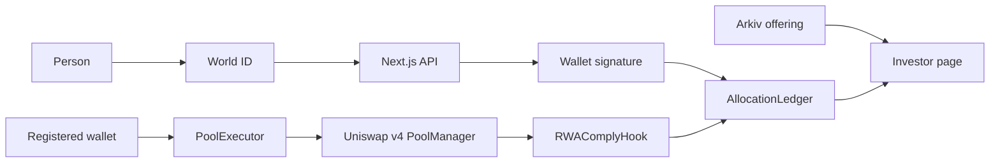

# Architecture

RWAComply has two paths. The purchase path can reject a swap. The offering path cannot.

The deployed Sepolia market is one pool and one allocation group. A local marketplace path, not deployed on Sepolia, gives each new offering its own group and cap. That design is [docs/MARKETPLACE_ARCHITECTURE.md](docs/MARKETPLACE_ARCHITECTURE.md).

## Identity and enrollment

The browser asks [`frontend/app/api/world/rp-context/route.ts`](frontend/app/api/world/rp-context/route.ts) for a short-lived signed context. The World signing key stays on the server. The first wallet uses an IDKit uniqueness proof. The server posts that result to World from [`frontend/app/api/world/enroll/route.ts`](frontend/app/api/world/enroll/route.ts). After World accepts it, the server creates a random allocation id and stores the session encrypted. The raw nullifier and the raw session id are not stored.

A later wallet uses `IDKit.proveSession`, not `IDKit.createSession`. [`frontend/app/api/world/continue/route.ts`](frontend/app/api/world/continue/route.ts) verifies that proof and returns a one-time continuation grant. The grant is not the allocation id.

## Backend authorization

[`frontend/app/api/world/wallet-challenge/route.ts`](frontend/app/api/world/wallet-challenge/route.ts) asks the connected wallet to sign an EIP-712 `WalletLink`. [`frontend/app/api/world/wallet-authorization/route.ts`](frontend/app/api/world/wallet-authorization/route.ts) checks that signature and returns a registration authorization signed by `ALLOCATION_AUTH_SIGNING_KEY`. The domain is `AllocationLedger` version `1`, bound to the chain id and the ledger address. The fields are wallet, allocation id, group id, expiry, and nonce.

[`frontend/app/api/world/registration-receipt/route.ts`](frontend/app/api/world/registration-receipt/route.ts) records a registration only after it reads the chain. A client success flag is not enough.

## Ethereum contracts

[`src/AllocationLedger.sol`](src/AllocationLedger.sol) stores the wallet-to-allocation mapping, the policy, and the gross USDC spend. Spend is keyed by allocation id, group, and period. `setPolicy` does not clear spend and cannot set the cap below spend already recorded. Nothing in the contract decreases spend.

The hook owner sets the access tier with `setTier`. That is not part of registration.

## Uniswap v4 execution

[`src/PoolExecutor.sol`](src/PoolExecutor.sol) is the only supported swap entry. The purchaser is `msg.sender`. The executor pulls that wallet’s USDC and calls the official PoolManager with the trader encoded as hook data.

[`src/RWAComplyHook.sol`](src/RWAComplyHook.sol) rejects any other router in `beforeSwap`. It checks the registered wallet’s remaining budget. `afterSwap` records the settled USDC. A revert undoes both the tokens and the spend. Exact output does not increase spend. Selling RWA does not reduce it.

The PoolManager is the pool infrastructure. It is not the budget. The hook is the enforcement point. The ledger is the record.

## Arkiv

[`frontend/lib/arkiv/offering.ts`](frontend/lib/arkiv/offering.ts) describes one public entity. [`frontend/app/api/offerings/route.ts`](frontend/app/api/offerings/route.ts) reads it. The investor page does not import the Arkiv SDK. A stopped Arkiv client leaves the purchase button on the Ethereum path.

## Frontend

[`frontend/components/product/InvestorExperience.tsx`](frontend/components/product/InvestorExperience.tsx) is the Sepolia investor flow. [`frontend/components/SwapDemo.tsx`](frontend/components/SwapDemo.tsx) is the local technical demo. [`frontend/app/api/product/purchases/route.ts`](frontend/app/api/product/purchases/route.ts) lists `SpendRecorded` logs for one wallet and omits the allocation id.

## Source of truth

| Record | Authority |
|---|---|
| Proof of human | World, checked by the server |
| Wallet ownership | The wallet’s EIP-712 signature |
| Registration, tier, cap, spend, remainder | Ethereum |
| Offering name, tokens, pool id, expiry | Arkiv |
| Purchase history for one wallet | `SpendRecorded` logs |

Decisions that were not built, including a per-swap trade signature, revocation, and a policy end time, are in [docs/ARCHITECTURE_DECISIONS.md](docs/ARCHITECTURE_DECISIONS.md).
